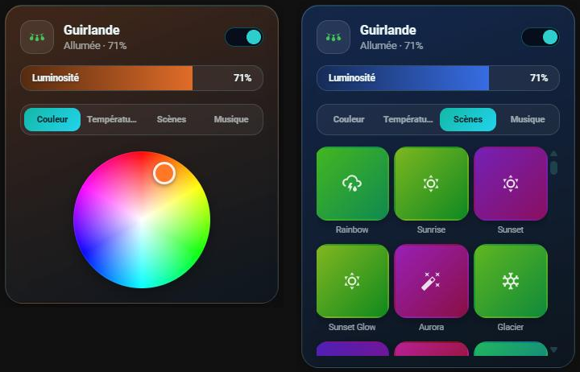

# 💡 HOLM Govee Light Card

[](https://hacs.xyz/)


[🇫🇷 Français](README.md) · 🇬🇧 English

**Your Govee lights in a modern card: brightness, colour, temperature, scene thumbnails and music mode.**

HOLM Govee Light Card is a Lovelace card designed for the **[Govee (lasswellt/govee-homeassistant)](https://github.com/lasswellt/govee-homeassistant)** integration. It follows its entity model: the light, the scene and DIY scene lists, and the music mode settings.

> ✨ **Full visual editor.** Pick the light and its entities in the editor; only `entity` is required.

### At a glance

- 💡 **On / off, brightness, colour and temperature**: colour wheel and smooth sliders, updated while dragging without flooding the Govee API.
- 🎬 **Scene thumbnails**: a visual picker for `select.<device>_scene` and `select.<device>_diy_scene` (Scenes / DIY tabs).
- 🎵 **Music mode**: switch, mode and sensitivity, if the entities exist.
- 🎨 **The card takes the light's colour**, including during a scene.
- 🌙 **Minimal card when the light is off**: only the header stays; everything comes back when turned on, on the last opened tab.
- 📂 **Collapsible panels**: only the header, brightness and tabs stay visible; a tap opens a panel.
- 🌍 **8 languages**: English, French, German, Spanish, Italian, Dutch, Portuguese and Polish.



*Screenshot in French — the card follows the language of your Home Assistant profile.*

### 🆕 What's new in 1.5.0

- 🌍 **The card speaks 8 languages**: English, French, German, Spanish, Italian, Dutch, Portuguese and Polish, editor included. It follows the language of your Home Assistant profile (English if your language isn't translated yet); the `language` option lets you force one.

---

## Installation

### With HACS (recommended)

1. HACS → ⋮ menu → **Custom repositories**.
2. Add `https://github.com/kaaribou/holm-govee-light-card`, category **Dashboard** (*Plugin*).
3. Search for **HOLM Govee Light Card** → **Download**.
4. Reload the page (Ctrl + F5).

### Manually

1. Copy `dist/holm-govee-light-card.js` to `config/www/community/holm-govee-light-card/`.
2. **Settings → Dashboards → ⋮ → Resources → Add**: `/local/community/holm-govee-light-card/holm-govee-light-card.js`, type **JavaScript module**.
3. Reload the page.

---

## Usage

```yaml
type: custom:holm-govee-light-card
entity: light.led_strip
scene_entity: select.led_strip_scene
diy_scene_entity: select.led_strip_diy_scene
music_switch_entity: switch.led_strip_music_mode
music_mode_entity: select.led_strip_music_mode
music_sensitivity_entity: number.led_strip_music_sensitivity
```

Without `scene_entity` or `diy_scene_entity`, the Scenes tab is disabled; the Music tab only appears if at least one music entity is set.

## Options

| Option | Description | Default |
|---|---|---|
| `language` | Language: `fr`, `en`, `de`, `es`, `it`, `nl`, `pt`, `pl` | the profile's |
| `entity` | Govee light (`light.*`) — **required** | — |
| `name` | Displayed name | entity name |
| `icon` | Icon | depends on the device |
| `icon_color` | Icon colour `[r, g, b]` | light colour |
| `scene_entity` / `diy_scene_entity` | Scene and DIY scene lists | — |
| `music_switch_entity` / `music_mode_entity` / `music_sensitivity_entity` | Music mode: switch, mode, sensitivity | — |
| `show_temperature` | Temperature tab | `true` |
| `collapsible` | Panels collapsed by default (one tap opens, a second closes) | `true` |
| `scene_images` | Use images for scenes (see below) | `true` |
| `image_path` | Scene images folder | `/local/images/govee_img/` |

## Scene thumbnails

Each scene has a **thumbnail generated** by the card (colour gradient and icon), always the same for a given name: nothing to install.

**Optional: the Govee app images.** If you have **Govee Desktop**, you can copy its scene images to `config/www/images/govee_img/`: the card recognises them (about a hundred scenes) and shows them instead of the thumbnails. A missing image is automatically replaced by the generated thumbnail. These images belong to Govee and are not provided with the card. The mapping list is in [MAPPING_REVIEW.md](MAPPING_REVIEW.md). To never use images: `scene_images: false`.

## FAQ / troubleshooting

| Problem | Solution |
|---|---|
| No Scenes tab | Set `scene_entity` (and/or `diy_scene_entity`) in the editor. |
| No Music tab | Set at least one music entity. |
| The card colour doesn't change during a scene | Govee doesn't always report the colour during an effect: the card keeps the last known colour. |
| RGBIC segments | `light.xxx_segment_N` entities are not handled by this card. |
| You were using `custom:govee-like-light-card` | This old name still works, but switch to `custom:holm-govee-light-card`. |
| The card is not in my language | Set `language` in the card, or open an issue to suggest a translation. |
| The new version doesn't show | Clear the cache (Ctrl + F5). |

---

## Say thanks?

Like the card? You can buy me a beer 🍺

[](https://paypal.me/kaaribou)

---

## License

Code: **MIT** license — © kaaribou. See the [CHANGELOG](CHANGELOG.md) (in French).

Part of **HOLM — Home Orchestration & Living Management**: smart management and orchestration of the home.

Other projects: [Carburant HOLM](https://github.com/kaaribou/carburant-holm) · [Climat HOLM](https://github.com/kaaribou/climat-holm) · [Volets HOLM](https://github.com/kaaribou/volets-holm) · [HOLM HP/HC](https://github.com/kaaribou/holm-tarif) · [HOLM Lektrico](https://github.com/kaaribou/lektrico-holm) · [HOLM LaMetric](https://github.com/kaaribou/lametric-holm) · [HOLM My Menu](https://github.com/kaaribou/holm-mymenu) · [HOLM Cars](https://github.com/kaaribou/holm-cars) · [HOLM GitHub](https://github.com/kaaribou/github-holm) · [HOLM Navbar Card](https://github.com/kaaribou/holm-navbar-card) · [HOLM Climate Card](https://github.com/kaaribou/climate-card-holm) · [HOLM Music Card](https://github.com/kaaribou/holm-music-card) · [HOLM Energy Cards](https://github.com/kaaribou/holm-energy-cards) · [HOLM Power Flow Card](https://github.com/kaaribou/holm-power-flow-card) · [HOLM Ecojoko Card](https://github.com/kaaribou/holm-ecojoko-card) · [HOLM Runtime Card](https://github.com/kaaribou/holm-runtime-card) · [HOLM Covers Card](https://github.com/kaaribou/holm-covers-card) · [HOLM Floor Card](https://github.com/kaaribou/holm-floor-card) · [HOLM Radiator Card](https://github.com/kaaribou/holm-radiator-card) · [HOLM Security Card](https://github.com/kaaribou/holm-security-card) · [HOLM Sentinel Card](https://github.com/kaaribou/holm-sentinel-card) · [HOLM Recordings Card](https://github.com/kaaribou/holm-recordings-card) · [HOLM Smoke Card](https://github.com/kaaribou/holm-smoke-card) · [HOLM Family Card](https://github.com/kaaribou/holm-family-card) · [HOLM Leapmotor Card](https://github.com/kaaribou/holm-leapmotor-card).
