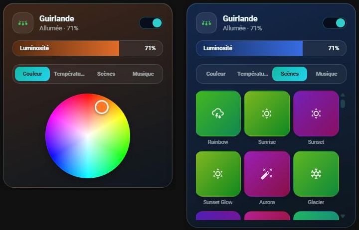

# 💡 HOLM Govee Light Card

[](https://hacs.xyz/)


**Vos lumières Govee dans une carte moderne : luminosité, couleur, température, scènes en vignettes et mode musique.**

HOLM Govee Light Card est une carte Lovelace pensée pour l'intégration **[Govee (lasswellt/govee-homeassistant)](https://github.com/lasswellt/govee-homeassistant)**. Elle colle à son modèle d'entités : la lumière, les listes de scènes et de scènes DIY, et les réglages du mode musique.

> ✨ **Éditeur visuel complet.** On choisit la lumière et ses entités dans l'éditeur ; seul `entity` est obligatoire.

### En bref

- 💡 **Marche / arrêt, luminosité, couleur et température** : roue de couleur et curseurs fluides, mis à jour pendant le glissement sans saturer l'API Govee.
- 🎬 **Scènes en vignettes** : un sélecteur graphique pour `select.<appareil>_scene` et `select.<appareil>_diy_scene` (onglets Scènes / DIY).
- 🎵 **Mode musique** : interrupteur, mode et sensibilité, si les entités existent.
- 🎨 **La carte prend la couleur de la lumière**, y compris pendant une scène.
- 🌙 **Carte minimale quand la lumière est éteinte** : seul l'en-tête reste ; tout réapparaît au rallumage, sur le dernier onglet ouvert.
- 📂 **Panneaux repliables** : seuls l'en-tête, la luminosité et les onglets restent visibles, un toucher ouvre un panneau.



---

## Installation

### Avec HACS (recommandé)

1. HACS → menu ⋮ → **Dépôts personnalisés**.
2. Ajoutez `https://github.com/kaaribou/holm-govee-light-card`, catégorie **Tableau de bord** (*Dashboard / Plugin*).
3. Recherchez **HOLM Govee Light Card** → **Télécharger**.
4. Rechargez la page (Ctrl + F5).

### Manuellement

1. Copiez `dist/holm-govee-light-card.js` dans `config/www/community/holm-govee-light-card/`.
2. **Paramètres → Tableaux de bord → ⋮ → Ressources → Ajouter** : `/local/community/holm-govee-light-card/holm-govee-light-card.js`, type **Module JavaScript**.
3. Rechargez la page.

---

## Utilisation

```yaml
type: custom:holm-govee-light-card
entity: light.bandeau_led
scene_entity: select.bandeau_led_scene
diy_scene_entity: select.bandeau_led_diy_scene
music_switch_entity: switch.bandeau_led_music_mode
music_mode_entity: select.bandeau_led_music_mode
music_sensitivity_entity: number.bandeau_led_music_sensitivity
```

Sans `scene_entity` ni `diy_scene_entity`, l'onglet Scènes est désactivé ; l'onglet Musique n'apparaît que si au moins une entité musique est renseignée.

## Options

| Option | Description | Par défaut |
|---|---|---|
| `entity` | Lumière Govee (`light.*`) — **obligatoire** | — |
| `name` | Nom affiché | nom de l'entité |
| `icon` | Icône | selon l'appareil |
| `icon_color` | Couleur de l'icône `[r, g, b]` | couleur de la lumière |
| `scene_entity` / `diy_scene_entity` | Listes des scènes et des scènes DIY | — |
| `music_switch_entity` / `music_mode_entity` / `music_sensitivity_entity` | Mode musique : interrupteur, mode, sensibilité | — |
| `show_temperature` | Onglet Température | `true` |
| `collapsible` | Panneaux repliés par défaut (un toucher ouvre, un second referme) | `true` |
| `scene_images` | Utiliser des images pour les scènes (voir ci-dessous) | `true` |
| `image_path` | Dossier des images de scènes | `/local/images/govee_img/` |

## Vignettes des scènes

Chaque scène a une **vignette générée** par la carte (dégradé de couleurs et icône), toujours la même pour un nom donné : rien à installer.

**Facultatif : les images de l'application Govee.** Si vous avez **Govee Desktop**, vous pouvez copier ses images de scènes dans `config/www/images/govee_img/` : la carte les reconnaît (une centaine de scènes) et les affiche à la place des vignettes. Une image absente est remplacée automatiquement par la vignette générée. Ces images appartiennent à Govee et ne sont pas fournies avec la carte. La liste des correspondances est dans [MAPPING_REVIEW.md](MAPPING_REVIEW.md). Pour ne jamais utiliser d'images : `scene_images: false`.

## FAQ / dépannage

| Problème | Solution |
|---|---|
| Pas d'onglet Scènes | Renseignez `scene_entity` (et/ou `diy_scene_entity`) dans l'éditeur. |
| Pas d'onglet Musique | Renseignez au moins une entité musique. |
| La couleur de la carte ne change pas pendant une scène | Govee ne remonte pas toujours la couleur pendant un effet : la carte garde la dernière couleur connue. |
| Les segments RGBIC | Les entités `light.xxx_segment_N` ne sont pas gérées par cette carte. |
| Vous utilisiez `custom:govee-like-light-card` | Cet ancien nom fonctionne encore, mais passez à `custom:holm-govee-light-card`. |
| La nouvelle version ne s'affiche pas | Videz le cache (Ctrl + F5). |

---

## Un petit merci ?

La carte vous plaît ? Vous pouvez m'offrir une bière 🍺

[](https://paypal.me/kaaribou)

---

## Licence

Code : licence **MIT** — © kaaribou. Voir le [CHANGELOG](CHANGELOG.md). Non affilié à Govee.

Fait partie de la collection **HOLM** — Home Orchestration & Living Management.
